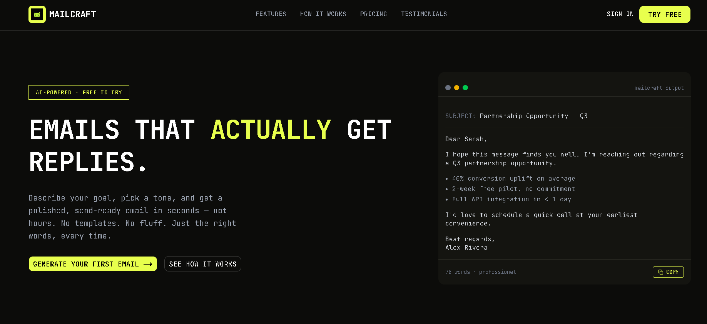
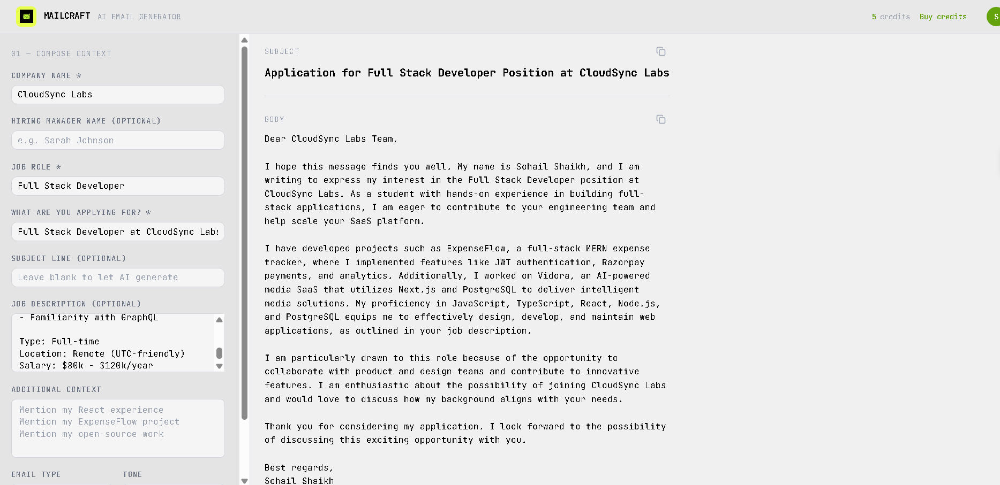

# MailCraft

AI-powered email generator for job seekers. Stop spending hours drafting cold emails.



## Demo Video

[](https://youtu.be/cuOIzpGdaVU?si=0B3D1LUFxbn9gggl)

## Problem

Job seekers spend 20-30 minutes crafting each application email, only to send generic messages that get ignored. MailCraft generates personalized, send-ready emails in seconds using your profile data — skills, projects, and experience level.



## Tech Stack

Next.js 16 · Supabase · OpenAI GPT-4o-mini · Tailwind CSS · shadcn/ui · Framer Motion

## Features

- AI email generation with 4 tone options
- Profile system with tech stack and projects
- Personalized output — AI only mentions skills you have
- One-click copy for subject, body, or full email
- GitHub & Google OAuth
- Forgot/reset password flow
- Mobile-first responsive design

## Getting Started

```bash
git clone https://github.com/your-username/mailcraft.git
cd mailcraft
npm install
cp .env.local.example .env.local
```

Add your keys to `.env.local`:

```
NEXT_PUBLIC_SUPABASE_URL=your-supabase-url
NEXT_PUBLIC_SUPABASE_PUBLISHABLE_KEY=your-supabase-anon-key
OPENAI_API_KEY=your-openai-api-key
NEXT_PUBLIC_SITE_URL=http://localhost:3000
```

```bash
npm run dev
```

## Deploy

```bash
npx vercel
```

## License

[MIT](LICENSE)